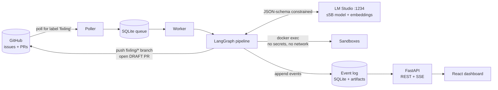
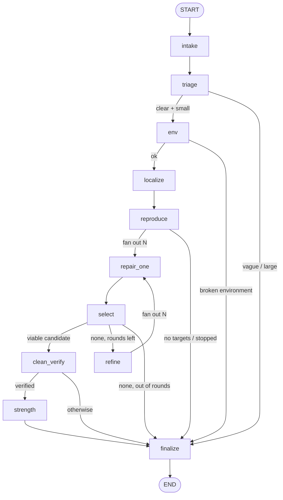

# Fixling

**A ≤5B-parameter model running on a consumer GPU that turns GitHub issues into verified, tamper-checked draft pull requests, with a replayable evidence trail.**

Fixling watches your repositories for issues labelled `fixling`. For each one it runs a fixed [LangGraph](https://langchain-ai.github.io/langgraph/) pipeline in which a small local model (served by [LM Studio](https://lmstudio.ai)) makes narrow, schema-constrained decisions and deterministic code does everything else. It:

1. writes a **failing test** that reproduces the bug,
2. samples several **candidate fixes** in parallel and runs each one in its own locked-down Docker sandbox,
3. re-verifies the winner in a **clean container** behind anti-test-tampering gates,
4. opens a **draft PR** whose description is built from an append-only event log, so every claim cites the event it came from.

> **Core idea: harness over model size.** Frontier-model research favours minimal bash-loop agents. With ≤5B models that flips: small models loop and stall, so the surrounding system has to carry the weight. Fixling is that system.

---

## Table of contents

- [Status](#status)
- [How it works](#how-it-works)
- [Architecture](#architecture)
- [The pipeline, node by node](#the-pipeline-node-by-node)
- [Test integrity: five layers](#test-integrity-five-layers)
- [Security model](#security-model)
- [Events, replay and crash recovery](#events-replay-and-crash-recovery)
- [Outcomes and confidence](#outcomes-and-confidence)
- [LLM usage and budgets](#llm-usage-and-budgets)
- [Evaluation](#evaluation)
- [Quickstart](#quickstart)
- [Configuration](#configuration)
- [CLI reference](#cli-reference)
- [HTTP API](#http-api)
- [Dashboard](#dashboard)
- [Project layout](#project-layout)
- [Tech stack](#tech-stack)
- [Development](#development)
- [Limitations](#limitations)
- [Further reading](#further-reading)

---

## Status

Everything below was built and tested **without a language model** (scripted test doubles stand in for it) and, where noted, against real Docker. What still needs a model, a GitHub token or an npm install is listed explicitly. Nothing here is claimed beyond what has run.

| Area | State | Verified how |
|---|---|---|
| Pipeline (intake → triage → env → localize → reproduce → repair ×N → select → refine → clean verify → finalize) | built | scripted-LLM end-to-end tests on a seeded bug; also over real Docker sandboxes |
| Test-integrity gate (41 hack diffs blocked, 14 legit diffs pass) and clean-container verification | built | corpus tests, red-team tests, hacks planted in a real container |
| Hardened sandbox (non-root, no capabilities, no network, read-only rootfs, protected tests) | built | real-Docker integration tests |
| Crash recovery (resume from checkpoint, no leaked containers) | built | killed mid-run and resumed, locally and in Docker |
| GitHub integration (poller, trusted push, draft PR, labels) | built | fake GitHub plus a real `git push` to a local bare repo; **not yet run against github.com** |
| API and live dashboard (SSE, replay, clarify/resume) | API built and tested; dashboard source written | API tests; the dashboard has **not been built or run** (`npm install` not run) |
| Evaluation harness (20 tasks, ablations, report, micro-benchmark) | built | tasks validated through the real grading path; **no results yet** |
| **Model bake-off, real fix rates, calibration numbers** | **not done** | needs LM Studio running a model |

---

## How it works



One run, in plain words:

1. The poller finds a `fixling`-labelled issue from a trusted author (owner, member or collaborator) and queues it.
2. The worker takes the job. The pipeline sanitises the issue text, turns it into a structured spec, and decides whether the issue is clear and small enough to attempt.
3. It builds (or reuses) a Docker image for the repo, runs the existing tests three times to learn the baseline and spot flaky tests, then finds the code most likely at fault with a mix of BM25, embeddings and stack-trace hints.
4. The model writes a new test that must fail with a real assertion error. That test is the definition of "fixed".
5. The model proposes several whole-function edits in parallel; each is applied in its own sandbox and judged by executed tests, not by opinion.
6. The best candidate is re-applied to a pristine tree in a fresh container, with the full suite run in fixed and shuffled order. Only then does Fixling open a draft PR.

When the model cannot find a fix, Fixling still ships something useful: a **repro-only** PR containing the validated failing test.

---

## Architecture

### Trust zones

```
 TRUSTED                                             UNTRUSTED
 controller process (token, LM Studio, event log)    issue text, repository contents, model output,
 host copy of the repo at base_sha                   everything that runs inside a sandbox
 Docker daemon / package index (build time only)
```

The **controller** is the only trusted process: it holds the GitHub token, talks to the model, owns the event log, and is the only thing that ever pushes. **Sandboxes** execute untrusted code and hold nothing.

### Containers per run

```
controller (host)
  ├── work sandbox            baseline test runs, reproduction test
  ├── candidate sandbox × N   one per repair candidate, each built from the trusted tree
  └── clean-verify sandbox    pristine base + final patch only, protected tests restored
```

### LangGraph graph (`src/fixling/graph/build.py`)



Design rules that make it robust:

- **Fixed pipeline, narrow model decisions.** The model never chooses what to do next. It answers one bounded question per call, with output forced into a JSON schema via LM Studio's `response_format: json_schema`.
- **`finalize` always runs.** Every stop condition (budget, cancel, error, nothing to do) routes there, and it never raises. Nodes never raise either: a wrapper in `graph/nodes/_common.py` turns budget hits, LLM outages and unexpected errors into a `stop_reason`, and later nodes become no-ops.
- **Fresh short prompts.** Each node builds a new prompt under 8k tokens from compact state, with a static system prefix (friendly to llama.cpp prefix caching) and a variable user part. If a prompt does not fit, `fit()` degrades it level by level instead of failing.
- **State stays small.** LangGraph state holds ids, specs, summaries and paths. Patches and prompts live in `runs/<id>/` and in event artifacts.

---

## The pipeline, node by node

| Node | What it does | Model call | If it fails |
|---|---|---|---|
| `intake` | Sanitises the untrusted issue and extracts an `IssueSpec` (kind, symptoms, expected behaviour, size, ambiguity) | `intake` | falls back to a heuristic spec, flagged `degraded_spec` |
| `triage` | Ambiguity ≥ 7, size = large, or kind = other → ask for clarification. In `--interactive` mode it pauses with `interrupt()` | none | in auto mode ends as `needs_clarification` |
| `env` | Builds or reuses the per-repo image, starts the work sandbox, runs the baseline suite 3× to find flaky tests | none | broken environment → `no_result` with the log |
| `localize` | BM25 + embeddings + hard hints (stack traces, symbols) fused with RRF; the model ranks files, then picks functions | `localize` ×2 | every answer is validated against the offered list; deterministic fallback |
| `reproduce` | Model writes a **new** failing test. Accepted only if it fails with an assertion (not an import/syntax/fixture error), passes the integrity rules, and fails deterministically | `reproduce` ≤ 3 | after 3 attempts continues without one; outcome capped at `unverified_fix` |
| `repair_one` × N | Whole-function search/replace edits, sampled at different temperatures, each applied in its **own sandbox** and tested (repro + impacted tests) | `repair` | apply/format errors are recorded per candidate |
| `select` | Policy gate per patch, de-duplicate, score. The judge only breaks exact ties | `judge` (tie-break only) | no viable candidate → `refine` or `finalize` |
| `refine` | Fresh prompt built from the best failed attempt and **why** it failed (max 2 rounds) | via `repair_one` | out of rounds → `finalize` |
| `clean_verify` | Applies test + fix to a pristine tree in a fresh container; full suite in fixed and shuffled order | none | a patch that does not apply is a blocking finding |
| `strength` (optional) | Independent tests written without seeing the patch | `extra_tests` | soft signal only |
| `finalize` | Outcome, confidence, `patch.diff`, `report.md`, push + draft PR + issue comment, closes all sandboxes | none | each step is isolated so one failure cannot lose the others |

### Editing format

Edits are exact-match search/replace blocks over a whole function (`repo/edits.py`). Matching tries exact → whitespace-normalised → unique fuzzy, and returns recovery-oriented errors so a retry can fix itself. Research behind this choice: fresh resampling beats localised span infill for small models, and sub-4B span splices often fail to parse.

### Retrieval (`repo/index.py`, `repo/retrieval.py`)

An AST index lists every function and class with signatures. Candidates come from three sources (BM25 over code chunks, embedding similarity from `fixling-embed`, and hard hints from stack traces and named symbols) and are merged with Reciprocal Rank Fusion. Embeddings are cached in SQLite so re-runs on the same repo are cheap.

---

## Test integrity: five layers

A coding agent's classic cheat is making the tests pass instead of making the code right. Fixling holds itself to the standard it enforces:

| Layer | What it does | Where |
|---|---|---|
| **L0** | Sandbox sees a fresh single-commit tree: no history, no `.git`. The base commit lives outside the workspace in a root-owned mount | `repo/workspace.py`, `sandbox/docker_sandbox.py` |
| **L1** | Protected files, and every directory containing one, are root-owned and read-only. `/workspace` itself is root-owned so the agent cannot move `tests/` away | `repo/workspace.py::build_tree_tar` |
| **L2** | Fail-closed **policy gate** on every diff: protected paths, size, binary/symlink, header consistency, skip/xfail, `sys.exit`, constant asserts, test-environment sniffing (`PYTEST_CURRENT_TEST`, `"pytest" in sys.modules`), always-true `__eq__`, secrets, credential files | `verify/policy.py`, `config/policy.yaml` |
| **L3** | Verification in a **fresh container** built from the trusted host copy. Results come from junit XML, never from the exit code alone | `verify/clean_verify.py`, `verify/runner.py` |
| **L4** | FAIL_TO_PASS (the reproduction test) and PASS_TO_PASS (baseline-passing tests, flaky ones excluded), plus a shuffled-order run | `verify/clean_verify.py` |

The gate runs in three places: before `select`, inside `clean_verify`, and again on a fresh clone before pushing. A bypass in one is caught by another.

Regression corpora live in `tests/fixtures/`: **41 hack diffs** that must be blocked and **14 legitimate diffs** that must pass. `tests/fixtures/make_corpus.py` regenerates them from real git diffs.

---

## Security model

Fixling feeds untrusted text to a weak model whose output becomes executable code, then optionally publishes the result under your GitHub identity. The full analysis, including what is **not** covered, is in [docs/THREAT_MODEL.md](docs/THREAT_MODEL.md). In short:

- **Sandbox hardening:** non-root (uid 10001), `cap-drop ALL`, `no-new-privileges`, read-only rootfs, RAM-backed workspace, CPU/memory/pid limits, `--network none`. Network is used only at image build time to install dependencies.
- **Secrets:** only the controller holds the GitHub token. Sandboxes get none. Every string written to the event log passes a secret redactor first, and patches containing credentials are dropped, not just flagged.
- **Untrusted input:** hidden Unicode and HTML-comment instructions in issues are stripped and flagged (`repo/sanitize.py`); issue and repo text is wrapped as data in prompts.
- **Trigger gate:** only issues from owners, members and collaborators start a run (`config/policy.yaml`).
- **Publishing:** only the controller pushes, only to `fixling/*` branches, only as **drafts**. PR bodies are built from facts in the log; model-originated text is stripped of links, images, HTML and `@mentions`. `Fixes #N` appears only for `verified_fix`.
- **Red-team tests:** `tests/security/` covers canary-secret leakage, prompt injection, network isolation and token absence.
- **Known gap:** Docker containers share the host kernel. For hostile repositories use gVisor or a microVM (documented upgrade path, not built).

---

## Events, replay and crash recovery

- **The event log is the source of truth.** The `events` table is append-only, enforced by SQLite triggers (`events_no_update`, `events_no_delete` in `db.py`). Event types include `run_started`, `issue_received`, `sanitize`, `spec`, `triage`, `env`, `retrieval`, `test_run`, `repro`, `llm_call`, `candidate`, `gate_finding`, `selection`, `judge`, `refine`, `verify`, `strength`, `outcome`, `git`, `pr_opened`, `comment`, `interrupt`, `resume`, `budget` and `error`.
- **Large outputs spill to disk.** Anything big goes to `runs/<id>/artifacts/<seq>.txt` with a head/tail copy inline. Every `llm_call` event stores the full prompt and response as an artifact.
- **The PR body and the dashboard are pure functions of the log** (`gh/pr_body.py`, `web/src/pipeline.ts`). Every evidence line cites `[event #N]`.
- **Replay** re-renders the log up to event N (`fixling replay <run_id>`).
- **Resume** uses LangGraph's SQLite checkpointer (`runs/checkpoints.sqlite`). A crash mid-run continues from the last superstep, and nodes that create sandboxes are idempotent so no containers leak. A reaper cleans up strays.
- **Concurrency:** one run at a time (single GPU). Parallelism is inside a run: N candidates sampled concurrently through LM Studio's continuous batching (4 slots by default), each in its own sandbox.

SQLite tables: `runs`, `events`, `sandboxes`, `embed_cache`.

---

## Outcomes and confidence

| Outcome | Meaning | PR |
|---|---|---|
| `verified_fix` | Reproduction test fails before and passes after in a clean container, no regressions, no integrity findings | draft PR, `Fixes #N`, label `fixling:verified` |
| `unverified_fix` | Best candidate has regressions, flags, or there was no reproduction test | draft PR, label `fixling:needs-review`, no `Fixes` |
| `repro_only` | A valid failing test, no passing fix | draft PR containing only the test |
| `needs_clarification` | Issue too vague or large (or paused for a human in `--interactive`) | issue comment with questions |
| `no_result` | Environment broken, budget hit, or model unavailable | issue comment with diagnostics |

Every PR carries a **confidence level** with reasons, computed only from recorded evidence (`verify/confidence.py`):

- **High** needs: verified (F2P and P2P, no blocking finding), no flags, shuffled order passes, corroboration (≥ 2 independent candidates produced the same patch, or independently written tests pass), and a confident judge if one ran.
- **Medium:** missing corroboration, any flag, an order-dependent suite, or judge concerns.
- **Low:** `unverified_fix`.
- `repro_only` and `no_result` carry no confidence.

---

## LLM usage and budgets

Calls go to LM Studio's OpenAI-compatible endpoint, so they cost GPU time, not money. Budgets are in `config/budgets.yaml`:

```yaml
run_wall_clock_s: 1500        # 25 minutes per run
run_max_llm_tokens: 250000
reproduce_attempts: 3
repair_candidates: 4
refine_rounds: 2
baseline_runs: 3
verify_shuffled: true
```

Model calls per issue, counted from the code:

| Step | Calls |
|---|---|
| intake | 1 |
| localize | 2 |
| reproduce | 1–3 |
| repair, round 0 | 4 (parallel) |
| refine | 0–8 (only if nothing passed) |
| judge | 0–2 (only on ties) |
| extra tests | 0–1 (off by default) |
| **Total** | **~8 when it goes well, 12–15 typical, ~21 worst case** |

Each structured call also gets one retry if the output fails schema validation, and connection errors are retried with backoff. Retrieval adds a few embedding calls.

Per-node sampling (temperature, max tokens, thinking on/off) lives in `config/models.yaml`. The default setup uses one main model (`fixling-main`) and one embedding model (`fixling-embed`), both loaded in LM Studio. An optional "expert escalation" hook exists but is off by default.

---

## Evaluation

The evaluation harness is the portfolio centrepiece, and it is honest by construction: the report is generated, never hand-edited, and says plainly that no results exist while none do.

- **Tasks:** 20 validated bugs in the `minicart` demo library (10 hand-written, 10 synthetic AST mutations), split into dev and held-out test slices. Each task is checked through the real grading path before it counts.
- **Metrics:** resolve@1 with bootstrap confidence intervals, pass@k, **false-pass rate** (verified claims the hidden tests rejected), a **calibration table** ("when Fixling says HIGH, it is right X% of the time"), repro-only rate, and time and tokens per resolved task.
- **Ablations** (`evals/ablations.yaml`), compared with paired exact McNemar tests: one candidate vs four vs eight, with vs without the reproduction test, BM25-only vs BM25 + embeddings, policy gates on vs off, Q4 vs Q8 quantisation.
- **Micro-benchmark** (`fixling bench-micro`): 30 small tasks (10 intake, 10 file ranking, 10 AST-judged edits) for choosing a model before running the full evaluation.

```bash
uv run fixling bench-micro --label qwen3-4b-q8 --write     # pick a model
uv run fixling eval --slice dev --k 1                       # smoke test on the dev tasks
uv run fixling eval --slice test --k 3                      # held-out baseline
uv run fixling eval --config evals/ablations.yaml#n8 --slice test --k 3
uv run fixling eval-report                                  # writes docs/EVAL_REPORT.md + charts
```

---

## Quickstart

**Requirements:** Windows, Linux or macOS · Python 3.12 via [uv](https://docs.astral.sh/uv/) · Docker (WSL2 backend on Windows) · LM Studio ≥ 0.4 with a ≤5B instruct model (Qwen3-4B-Instruct, Phi-4-mini and Gemma 4 E4B are the planned candidates; Q8 or Q6 recommended) · Node 20+ only for the dashboard. Step-by-step setup is in [docs/SETUP.md](docs/SETUP.md).

```bash
uv sync
cp .env.example .env                 # optional for local runs
uv run fixling doctor --deep         # checks LM Studio, Docker, base image, sandbox isolation

# fix a bug in a local repository from a markdown issue (first line = title)
uv run fixling run --repo path/to/repo --issue-file issue.md
#   -> runs/<id>/patch.diff and runs/<id>/report.md
uv run fixling replay <run_id>       # re-render the run's events

# the full service: poller + worker + API + dashboard
uv run fixling serve                 # http://127.0.0.1:8000
cd web && npm install && npm run build   # one-off: builds the dashboard served by `serve`
```

Local runs never publish by default (`--no-pr`). Add `--pr` with a GitHub token to push a branch and open a draft PR.

---

## Configuration

| File | Purpose |
|---|---|
| `config/models.yaml` | LM Studio URL, model identifiers, context length, per-node sampling, parallel slots, optional expert model |
| `config/budgets.yaml` | wall-clock, token, attempt and timeout limits; baseline runs; shuffled verification |
| `config/policy.yaml` | protected globs, protected `pyproject` sections, generated-test directory, diff size limits, forbidden commands, trusted author associations |
| `evals/ablations.yaml` | named configuration overrides for ablation runs |
| `.env` | secrets and paths (copy from `.env.example`) |

Environment variables (all optional for local runs):

| Variable | Meaning |
|---|---|
| `GITHUB_TOKEN` | fine-grained PAT scoped to demo repos only: Contents RW, Pull requests RW, Issues RW, Metadata R |
| `FIXLING_REPOS` | comma-separated repos the poller watches |
| `LMSTUDIO_BASE_URL` | only if LM Studio is not on this machine |
| `FIXLING_RUNS_DIR` | where run artifacts and SQLite databases live (default `./runs`) |
| `FIXLING_DASHBOARD_URL` | dashboard link written into PR bodies |
| `FIXLING_LOCAL_ROOTS` | directories the API may copy for local runs (empty = off) |
| `FIXLING_CANARY` | random value used by the red-team tests; anything equal to it is treated as a secret |

---

## CLI reference

| Command | Purpose |
|---|---|
| `fixling doctor [--deep]` | Check LM Studio, Docker, the base image and GitHub token; `--deep` also starts a sandbox and proves it has no network |
| `fixling run --repo <path\|owner/name> (--issue N \| --issue-file F)` | Run the pipeline once. Options: `--pr/--no-pr`, `--interactive`, `--embeddings/--no-embeddings`, `--strength`, `-v` |
| `fixling replay <run_id> [--after SEQ]` | Print the run's events |
| `fixling serve [--port 8000] [--host 127.0.0.1]` | Start poller, worker, API and dashboard. Keep the default host: the API has no authentication |
| `fixling bench-micro --label NAME [--k] [--node] [--write]` | Run the 30-task model micro-benchmark |
| `fixling eval [--slice dev\|test\|all] [--k] [--config] [--task ID]` | Run the evaluation |
| `fixling eval-report` | Regenerate `docs/EVAL_REPORT.md` and charts from results |

---

## HTTP API

Served by FastAPI (`src/fixling/api/app.py`). Live updates use Server-Sent Events.

| Method | Path | Purpose |
|---|---|---|
| GET | `/api/health` | LM Studio, Docker and queue health |
| GET | `/api/stats` | aggregate run statistics |
| GET | `/api/runs` | list runs |
| POST | `/api/runs` | start a run |
| GET | `/api/runs/{id}` | run details |
| GET | `/api/runs/{id}/summary` | outcome, confidence, evidence summary |
| GET | `/api/runs/{id}/events` | events (supports `after`) |
| GET | `/api/runs/{id}/stream` | live SSE event stream (subscribes before replaying, so no event falls into the gap) |
| GET | `/api/runs/{id}/artifacts/{seq}` | spilled event artifact (prompt, test output) |
| GET | `/api/runs/{id}/files/{name}` | `patch.diff`, `report.md` |
| GET | `/api/runs/{id}/candidates` | candidate patches with gate and test results |
| POST | `/api/runs/{id}/resume` | answer a clarification and continue |
| POST | `/api/runs/{id}/cancel` | cancel a run |
| GET | `/api/evals` | evaluation results |

The API has no authentication and binds to localhost by default.

---

## Dashboard

A React + Vite + TypeScript app in `web/`, and the only JavaScript in the project. It is a pure view of the event log: pipeline graph, timeline, candidate diffs, verification results, clarify-and-resume panel, health bar, and an evaluation page. Build once with `npm run build`; `fixling serve` then serves it.

---

## Project layout

```
src/fixling/
  config.py, db.py, models.py, errors.py, runs.py, services.py, worker.py, cli.py
  events/       append-only event store + SSE pub/sub
  llm/          LM Studio client (constrained decoding, retry, embeddings), prompt rendering, prompts/*.md.j2
  repo/         AST index, hybrid retrieval, edit applier, sanitizer, workspace tarballs, env setup
  sandbox/      hardened Docker sandbox, image builder, reaper, Dockerfile.base
  verify/       pytest runner (junit), policy gate, secret scanner, clean verify, strength, confidence
  graph/        state, deps, guards (budgets, cancel, stuck detection), selection, nodes/, build, pipeline runner
  gh/           REST client, trigger-gated poller, trusted push, publisher, PR body builder
  api/          FastAPI app and server
  evals/        task schema, grader, runner, statistics, report, charts, micro-benchmark, bug builders
web/            React dashboard
demo-repos/     minicart: the library the evaluation tasks are bugs in
evals/          tasks.jsonl, ablations.yaml, results/
tests/          unit/, integration/, security/ + fixtures (hack and legit diff corpora, tiny_repo)
docs/           ARCHITECTURE, THREAT_MODEL, SETUP, MODEL_BAKEOFF, EVAL_REPORT, plan and research notes
config/         models, budgets, policy
```

---

## Tech stack

Python 3.12 · [uv](https://docs.astral.sh/uv/) · LangGraph + `langgraph-checkpoint-sqlite` · `openai` SDK pointed at LM Studio · pydantic v2 · Docker SDK · FastAPI + `sse-starlette` + uvicorn · `httpx` (GitHub REST) · `rank-bm25` + numpy (retrieval) · stdlib `ast` · `unidiff` · `junitparser` · Typer + Rich (CLI) · Jinja2 (prompts) · pytest (+ pytest-timeout, pytest-randomly in sandboxes) · ruff + mypy (strict) · React + Vite + TypeScript.

---

## Development

```bash
uv run pytest -q                       # unit + local-sandbox graph tests (no Docker, no model)
uv run pytest -m docker                # real Docker sandboxes and pipeline tests
uv run pytest -m live                  # needs LM Studio running
uv run ruff check . && uv run ruff format . && uv run mypy src
uv run python tests/fixtures/make_corpus.py   # regenerate the policy hack/legit corpora
```

Tests are split by marker: the default run excludes `docker` and `live`. The `FakeLLM` in `tests/fakes.py` scripts model answers so the whole pipeline can be exercised deterministically.

---

## Limitations

- Targets **well-scoped, single-function bugs in small Python repositories**. It will not rewrite your architecture. When it cannot fix an issue it ships the failing test instead.
- A 4B model fails often. The harness exists to make failure cheap, visible and non-misleading, not to hide it.
- The evaluation set is small and mostly synthetic (one demo repository), and no public-benchmark numbers exist yet, so results are not comparable to published SWE-bench scores.
- The same small model acts as judge, so it is used only as a tie-breaker and never overrides test results.
- Docker isolation is weaker than gVisor or a microVM; see the threat model.
- Python only in v1.

---

## Further reading

- [docs/ARCHITECTURE.md](docs/ARCHITECTURE.md): the design, the research behind it, and known deviations from the plan
- [docs/THREAT_MODEL.md](docs/THREAT_MODEL.md): assets, attackers, controls and uncovered risks
- [docs/SETUP.md](docs/SETUP.md): installing LM Studio, Docker and models
- [docs/MODEL_BAKEOFF.md](docs/MODEL_BAKEOFF.md) and [docs/EVAL_REPORT.md](docs/EVAL_REPORT.md): generated results (empty until a model is run)
- [docs/PLAN.md](docs/PLAN.md) and [docs/IMPLEMENTATION_PLAN.md](docs/IMPLEMENTATION_PLAN.md): the original plan and build spec
- [docs/research/](docs/research/): background research notes
